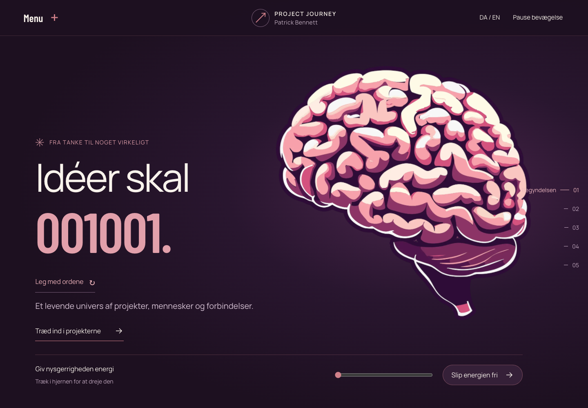
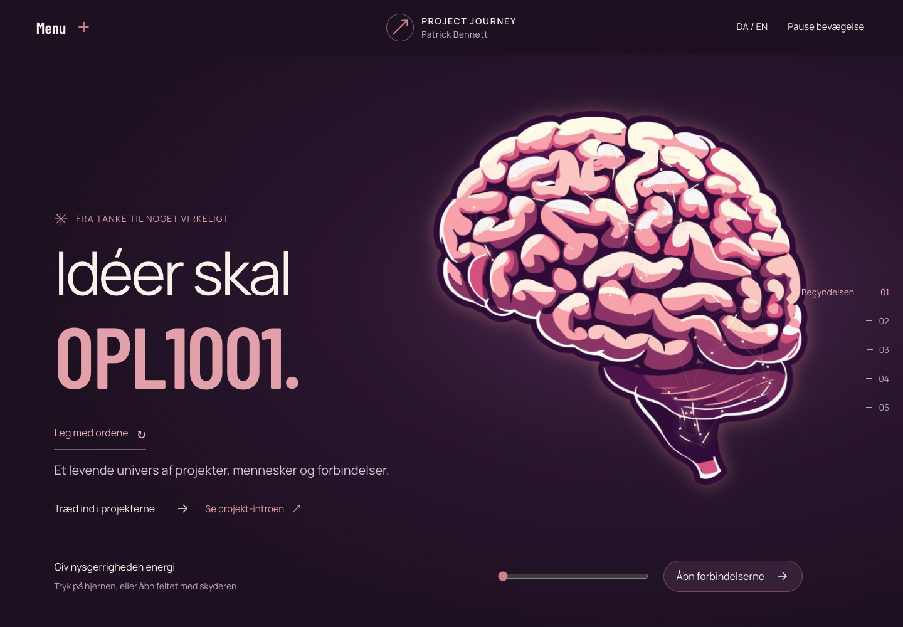
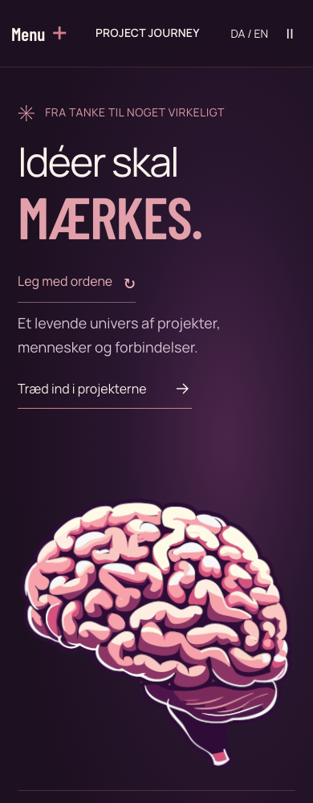
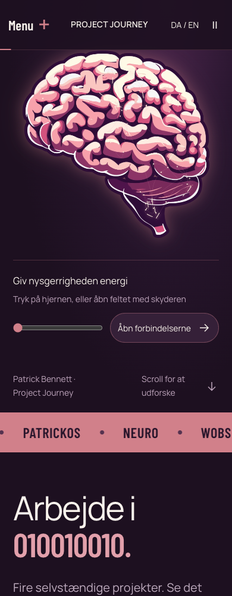
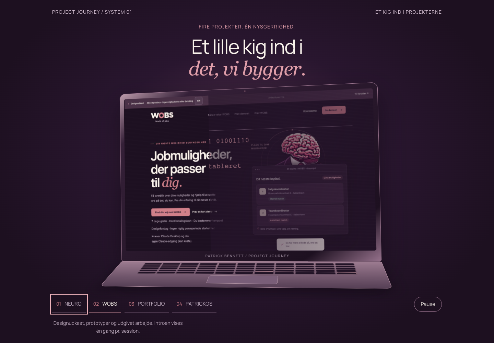
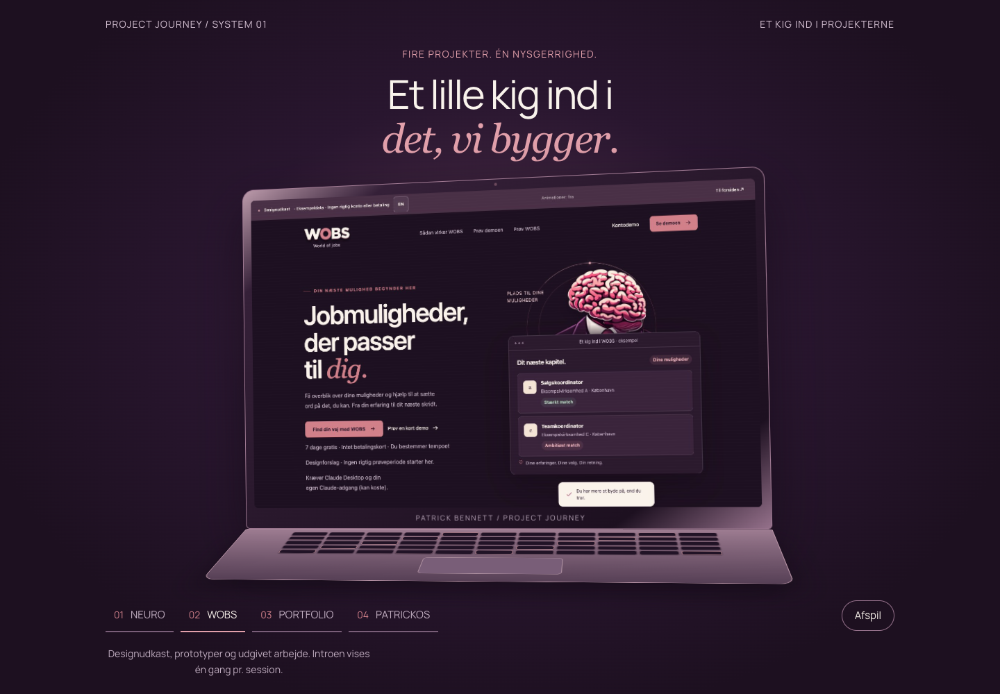
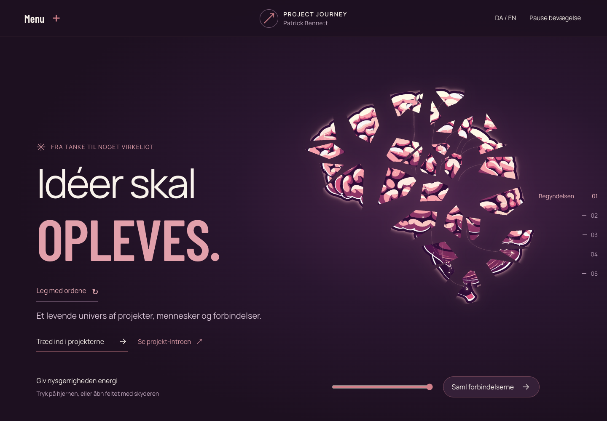
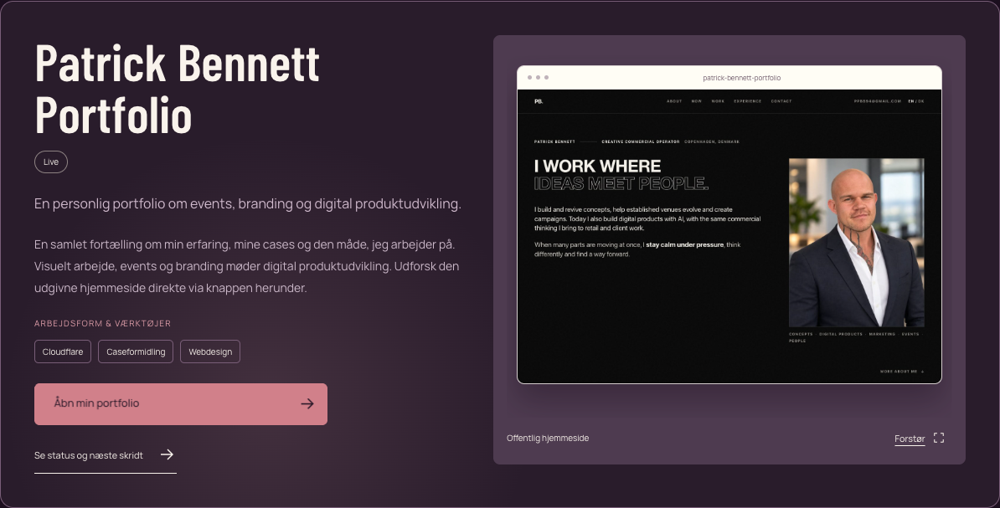
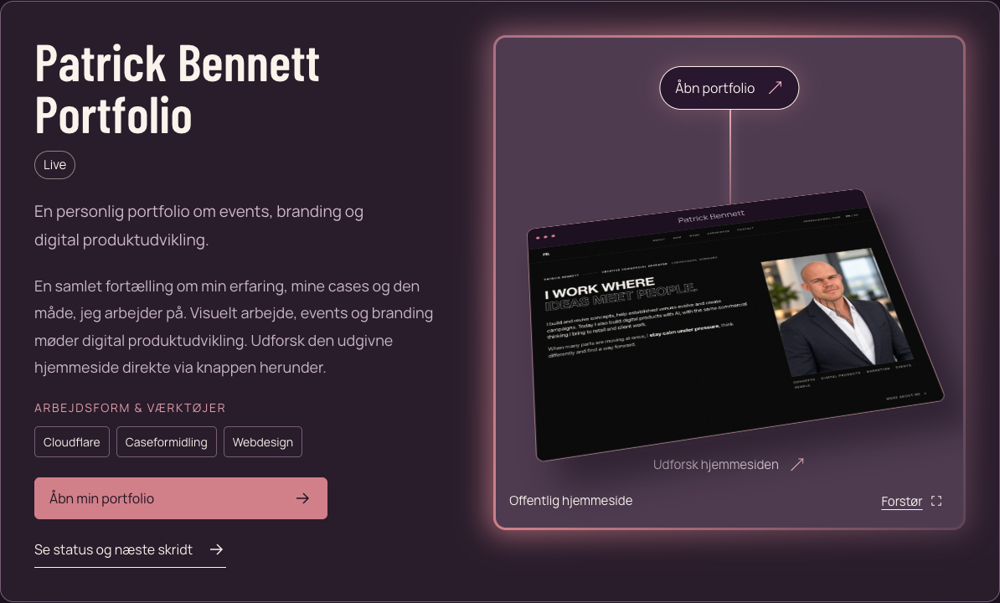
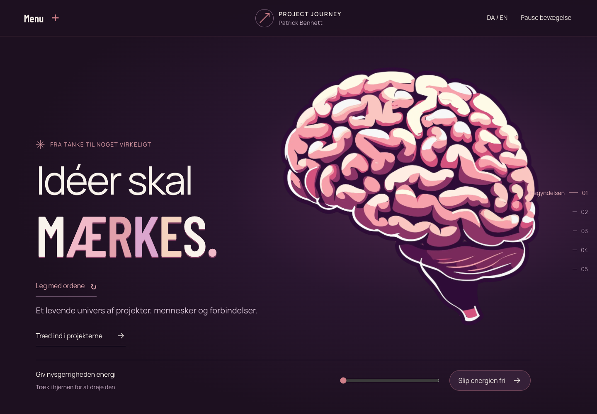

# Project Journey · designrejse

## Projekt og links

- **Hostet hjemmeside:** https://patrick-project-journey.patrickbennett.chatgpt.site
- **Genafspil intro:** https://patrick-project-journey.patrickbennett.chatgpt.site/?intro=1
- **GitHub:** https://github.com/PebeDauda/patrick-project-journey/tree/preview/project-journey-redesign
- Denne dokumentation handler om Project Journey. Patrick Bennetts sorte portfolio er et separat projekt; dens kode er ikke ændret. Portfolioen præsenteres og linkes fra Project Journey.

## Hvad er ændret?

1. NEURO og WOBS står først. Portfolio og PatrickOS følger. Creative Studio og Career Discovery er fjernet fra den aktive side.
2. WOBS-inspireret lilla/rosa/creme-palette, lokale Manrope/Barlow-fonte, større brødtekst og labels samt fælles tekst-/billedankre. Ingen udokumenterede færdiggørelsesprocenter.
3. Stor kinetic-menu til venstre og levende kapitelindex til højre. Forskellige visuelle motiver pr. menupunkt; DA / EN og ingen lokationstekst i den skrevne sidekopi.
4. Faktiske NEURO-/WOBS-web- og app/demo-skærme, status og næste skridt, projektkontekst/værktøjer, zoom og gradientglød bag forhåndsvisningerne. PatrickOS er tydeligt et illustreret arbejdsrum, ikke en verificeret færdig app.
5. Fem interaktive procesillustrationer og et visuelt storyboard. Procesbaggrunden blev gjort mørkere og varmere creme.
6. Hvem er jeg med Patricks eksisterende portfolio-portræt, 3D-kort, lys og direkte portfolio-link.
7. Tæt binær tekstanimation: 0/1 bliver til hele ord, med naturlig kerning. Den flerfarvede tekst blev erstattet af den eksisterende rosa farve.
8. Fire modsat bevægende rækker med 12 dokumenterede værktøjer. Pause og statisk udgave ved reduceret bevægelse.
9. Portfolioens preview er et klikbart 3D Pin-kort med lysende forbindelse, hover-tilt og direkte link. Mobiltryk, tastatur og forstørrelse er testet.
10. **Sidste ændring:** MacBook-inspireret intro med fire projektslides, terminal-/binære overgange, automatisk afslutning og genafspilning. Ingen spring-over-knap efter Patricks sidste instruktion. Native Escape virker fortsat; reduceret bevægelse viser en rolig udgave med indgang til siden.
11. **Sidste hjerneeffekt:** Genkendelig hjerne med bevægende elektriske signaler, organisk fragmentering og forbindelser mellem delene. Tryk skaber en impuls; skyderen åbner/samler feltet. Det er en kunstnerisk illustration, ikke en anatomisk model eller en medicinsk påstand.

## Dokumentationens nøjagtighed

Der er løbende gemt screenshots fra flere designversioner. Ikke hver mikroændring har et nøjagtigt før/efter-par. Filer med `v4` til `v12` er bevarede historiske snapshots fra forløbet. Deres versionsnavne er bevaret. Der er ikke rekonstrueret falske før-billeder.

`before-final-*` er frisk optaget fra den offentligt hostede version før den sidste MacBook-/hjerneændring. `after-*` dokumenterer den sidste version ved samme viewport (desktop 1440×1000, mobil 390×1000; også 320px kontrollen). Intro- og aktive hjerneframes viser forskellige animationstilstande; et screenshot dokumenterer ikke i sig selv hele bevægelsen. Før/efter ændrer også det roterende nøgleord afhængigt af tidspunktet.

## Forside: før den sidste ændring / efter

### Før / tilstand A

### Efter / tilstand B

## Mobil: før / efter

### Før / tilstand A

### Efter / tilstand B

## Ny MacBook-intro

### Før / tilstand A

### Efter / tilstand B

## Ny hjerne: samlet / åbent felt

### Før / tilstand A

### Efter / tilstand B

## Portfolio: før 3D Pin / med 3D Pin

### Før / tilstand A

### Efter / tilstand B

## Typografi: flerfarvet forsøg / samlet rosa

### Før / tilstand A

### Efter / tilstand B

## Flere dokumenterede trin

- [Tidlig partikelforside](assets/v4-hero-1440.png)
- [Hel hjerne i V5](assets/v5-hero-1440.png)
- [Portrætkort](assets/v6-about-1440.png)
- [Større projekttekst](assets/v7-project-1440.png)
- [Værktøjsrækker](assets/v9-tools-1440.png)
- [Gradientramme](assets/v10-gradient-1440.png)
- [Mørkere creme](assets/v11-warm-cream.png)
- [Portfolio-pin på mobil](assets/pin-390.png)
- [MacBook-intro på mobil](assets/after-mac-intro-390.png)
- [Åbent hjernefelt på mobil](assets/after-brain-field-390.png)

## Inspirationskilder og hvordan de blev brugt

- **WOBS design:** https://wobs-design-demo.patrickbennett.chatgpt.site/ · farver, varme og visuelt slægtskab.
- **Sterling Gate kinetic navigation:** https://21st.dev/@hardikkashiyani123456788/components/sterling-gate-kinetic-navigation · stor menu, stagger og skiftende visuelle motiver.
- **21st.dev templates:** https://21st.dev/community/templates/free · offentlig inspiration fra Brindle, Ferrow, Midblock og Card Stack til sideindex, rytme og scroll. Sticky overlap blev afprøvet og fjernet, fordi det dækkede kontroller.
- **Aceternity 3D Card:** https://ui.aceternity.com/components/3d-card-effect · portrættets perspektiv og lag.
- **Card Spotlight:** https://ui.aceternity.com/components/card-spotlight · markørstyret lys på projektkort.
- **Magnetic Button:** https://ui.aceternity.com/components/magnetic-button · rolig bevægelse i linkindholdet, med stabilt klikfelt.
- **Colourful Text / Flip Words:** https://ui.aceternity.com/components/colourful-text og https://ui.aceternity.com/components/flip-words · afprøvet typografi; farvevariationen blev senere fravalgt.
- **Encrypted Text:** https://ui.aceternity.com/components/encrypted-text · binærtal der bliver til rigtig tekst.
- **Logo Cloud Multiple Rows:** https://ui.aceternity.com/blocks/logo-clouds/logo-cloud-multiple-rows · fire modsat bevægende værktøjsrækker med tomme felter og fade.
- **Background Gradient:** https://ui.aceternity.com/components/background-gradient · gradientkant og blød glød bag previews.
- **3D Pin:** https://ui.aceternity.com/components/3d-pin · klikbar portfolio-forhåndsvisning med pin/tilt.
- **MacBook Scroll:** https://ui.aceternity.com/components/macbook-scroll · laptop, åbnende skærm og rumlig præsentation. Tilpasset som en tidsstyret intro med egne projekter, ikke kopieret som en scroll-side.

Implementeringerne er skrevet til det eksisterende projekt ud fra offentlige eksemplers visuelle principper. Betalt komponentkode er ikke kopieret. Hjerneeffekten er egen Canvas-komposition med det eksisterende brain-asset. Logoer/fonte har licensfiler i repository.

## Kilder, status og begrænsninger

Projektstatus er kildebaseret fra projekternes egne noter. NEURO er prototype, WOBS er motor plus syntetisk demo, Portfolio er udgivet, og PatrickOS er et arbejdsrum. Der er ikke bygget backend eller lanceret produkter i disse projekter som del af designarbejdet.

Build/HTML-smoke og browserkontroller omfatter desktop/mobil, menu, sprog, pause, reduceret bevægelse, introens afslutning/genafspilning og åbent hjernefelt. Se `finale-qa.json`. Fysisk iPhone/Safari/VoiceOver og generel brugeraccept er ikke verificeret. De otte tidligere Sanity/Cloudflare/studio-typefejl er fortsat kendte; der påstås ikke et fuldt TypeScript-pass.

## Klar til Obsidian

Kopiér hele denne mappe samlet, inklusive `assets/`, ind under projektets dokumentation i det korrekte vault. Relative Markdown-billedlinks virker uden ændringer. `gallery.html` er en ekstra side-om-side-visning i browseren. Bevar eksisterende noter, noter projektgrænsen til den sorte portfolio, og brug versionerne til at beskrive designbeslutninger frem for at kalde alle forsøg godkendte.
