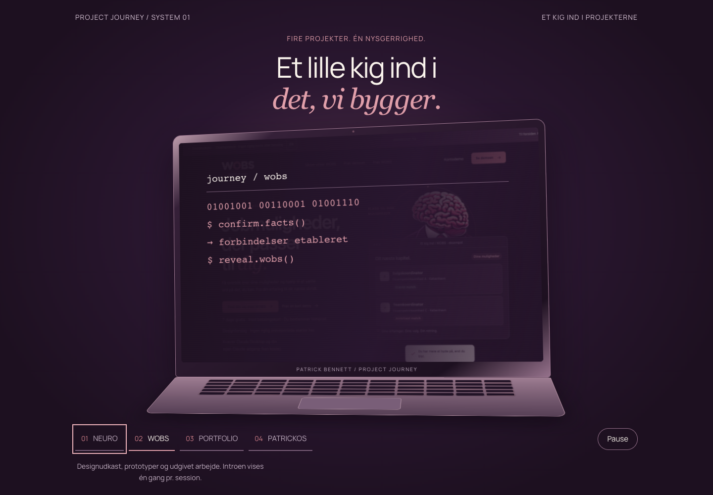
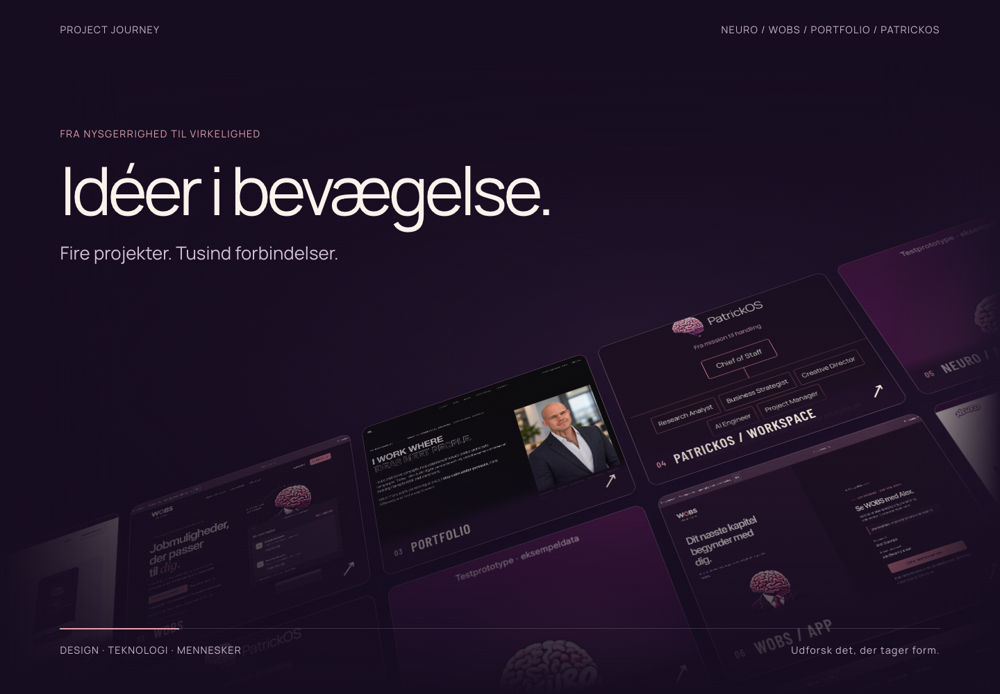
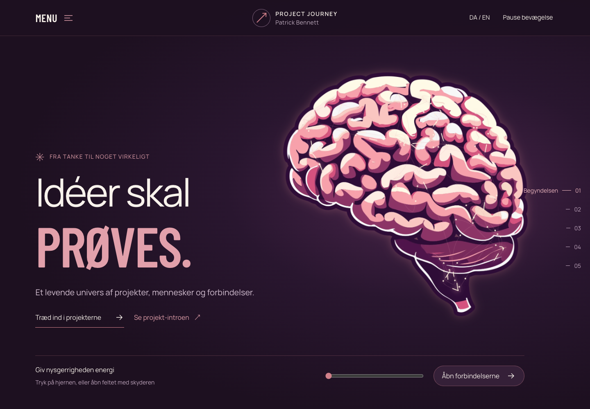
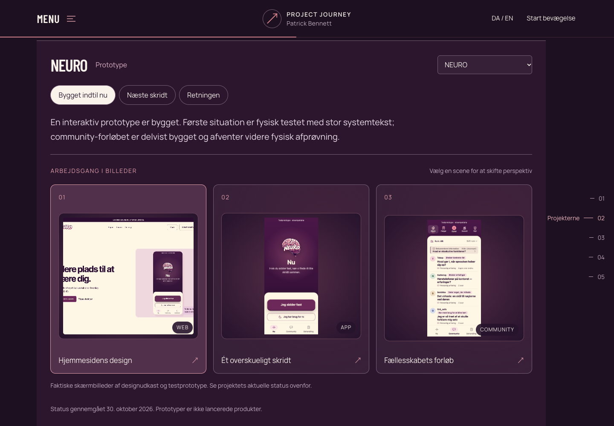
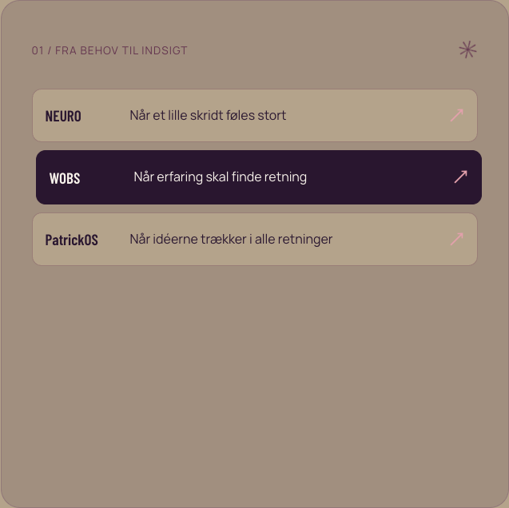
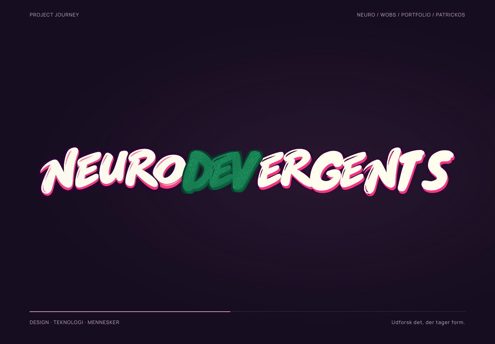
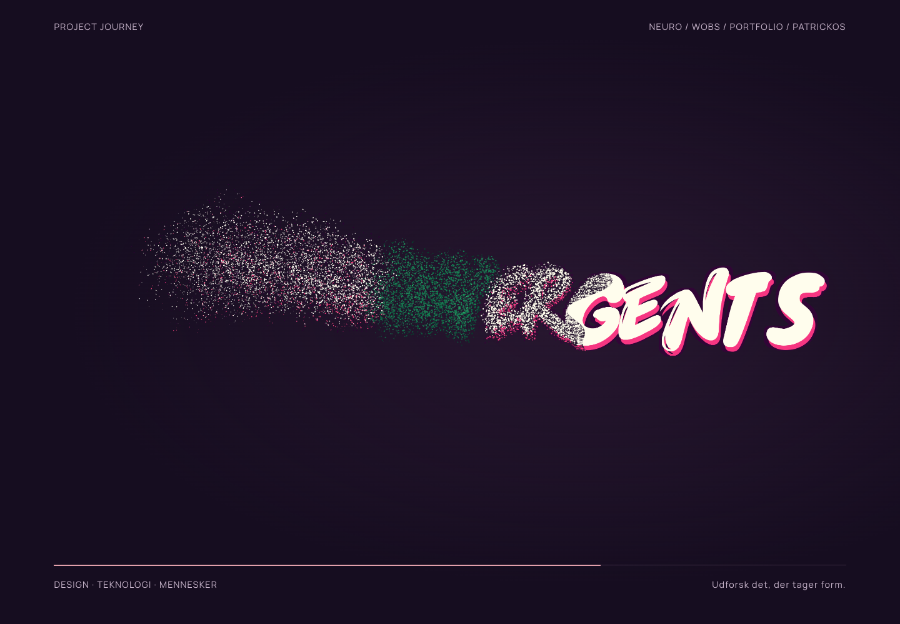
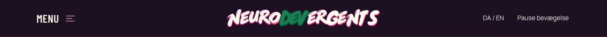

# Designændringer ·31. oktober 2026

Bestilling og retning blev gemt før kode som GitHub-commit b9a6996. Implementeringscheckpoint: b325980. Den nye intro er inspireret af [Ruixen Tilted Grid Hero på 21st.dev](https://21st.dev/?preview=%2F%40ruixen.ui%2Fcomponents%2Ftilted-grid-hero): egen billedkomposition med projektets screenshots, mørk lilla og blød fade til hel hjerne. Ingen MacBook-model, ingen kopierede stockfotos. PatrickOS-billedet er et skærmbillede af Journeys eksisterende arbejdsrumsillustration og er ikke en påstand om en færdig app.

## Før og efter
Før-billederne er faktiske optagelser af den publicerede version15 den31. oktober før ændringer. Efter-billederne er faktiske browseroptagelser af dagens arbejdskopi, ikke genererede mockups. Der er præcise før/efter-par for intro og hero; øvrige screenshots dokumenterer den nye tilstand. Der findes ingen opdigtede før-billeder.

- before-intro.png / after-intro-grid.png / after-intro-brain.png
- before-hero.png / after-hero.png
- after-menu.png, after-brain-unfolded.png, after-neuro-storyboard.png
- after-discover.png, after-about.png
- after-mobile-hero.png, after-mobile-intro.png, after-mobile-discover.png

Krav: ../../MUST-HAVE-2026-10-31.md. Ø-undersøgelse: ../../FONT-SPACING-2026-10-31.md. Browserkontrol: qa.json. Konto-usage kan ikke aflæses af agenten; seneste brugerangivelse var22% ved bestilling. Alt arbejde gemmes i projektet og på preview-branchen.

NEURO community-billedet er taget fra den eksisterende testprototype på /prototype/#s2-1 (syntetiske eksempelopslag). NEURO/WOBS-logoer er kopieret fra egne projekters eksisterende assets. Øvrige inspirationer og tidligere29 screenshots bevares i ../2026-10-30/DESIGN-JOURNEY.md.

## Visuel dokumentation

Før: 

Efter: 

Dagens dokumentation indeholder 15 faktiske screenshots med SHA-256 i capture-manifest.json. Sidste pakkede kilde: ec773c822258f839c0909c90dca0311494d6b5eb, Sites version16. Pause-kanttilstanden er også testet i denne pakke.

## Opfølgning · kortere intro og tydeligere WOBS
Efter Patricks gennemgang: intro reduceret fra9 til6sekunder (målt6049ms i browseren), sidste hjerne fjernet, blødt fade direkte fra billedgrid til siden. Nyt afslutningslogo afventes fra Patrick; ingen erstatning er opfundet. Projektbånd er ændret til mellemlilla #6b5874, og den eksisterende lyse WOBS-logovariant bruges. Faktisk målt logokontrast: cremefarvede bogstaver5,86:1, rosa O2,20:1. Logoet er visuelt kontrolleret på det nye bånd. Fotos: v17-shorter-intro.png og v17-logo-ribbon.png. Kontrol: v17-qa.json.

## NEURODEVERGENTS · logo og partikelafslutning
Patricks leverede PNG er kopieret uændret fra Dropbox. SHA-256 og proveniens er gemt i v18-logo-provenance.json. Den originale fil er ikke redigeret. Logoet bruges i stedet for pilen og den typografiske Project Journey-tekst i headeren. På mobil får det sin egen række, så det brede logo ikke klemmes.

Introen viser logoet helt før en organisk erosionsfront frigiver dets egne pixels som fint støv. Hver partikels RGB/alpha kommer direkte fra den originale creme/rosa/grønne grafik. Der er 23951 partikler på1440px testvisningen, færre på mobil. Hele forløbet er målt til6441ms. Reduceret bevægelse viser det intakte logo med en fungerende adgangsknap. Ingen afsluttende hjerne og ingen springover-knap.

Visuel inspiration: [Swiss branding AVA Particles visual af Gleb Kuznetsov](https://dribbble.com/shots/22498207-Swiss-branding-AVA-Particles-visual). Implementeringen er en egen let Canvas2D-fortolkning med organisk strømning og dybdevariation, ikke en kopi af referencens3D-simulation.

Browserkontrol: v18-qa.json. Mobilfejl med en for bred fullscreen-dialog blev fundet og rettet; normal og reduceret mobilvisning er kontrolleret. Build/artifact/HTML-smoke består. De samme8 eksisterende TypeScript-fejl uden for ændrede komponenter består; ingen nye fejl i logo-komponenten.

